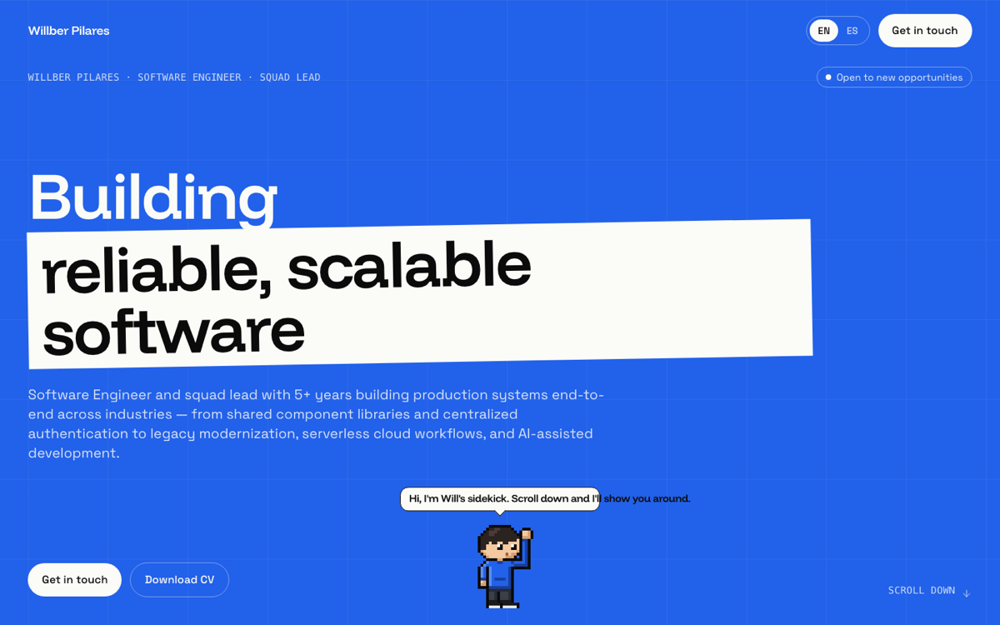

# Willber Pilares — Portfolio

Personal portfolio of a Software Engineer and squad lead with 7+ years building production systems end-to-end.

**Live:** [wpilares.vercel.app](https://wpilares.vercel.app)



## Overview

A bilingual (English / Spanish) portfolio told as a gothic Victorian hunter's journal. Scrolling turns the pages of nine scenes: an ink prologue, the city under the moon, the hunter's study, the armory of skills, a gallery of past hunts, the inventor's lab for NetPulse, an archive of hunts to come, a belfry to send a raven, and a candlelit epilogue. Every backdrop is procedural pixel art generated from a seed and painted to a canvas, and an orange-and-white cat companion with a cape, hat and lantern walks along, reacts to the scene in view, changes outfit per chapter, and can be picked up and dragged.

The aesthetic is inspired by gothic Victorian fiction and games of that mood; it uses no game assets, and every sprite, backdrop and ornament is original and authored in code.

## Tech stack

| Area | Tools |
|------|-------|
| UI | React 18, TypeScript 5, Tailwind CSS 3 |
| Motion | `motion` (scroll progress, lazy-loaded animation features, `motion/mini` for one-off flights) |
| Fonts | `@fontsource/unifrakturmaguntia` (titles), `@fontsource/im-fell-english` (labels and numerals), `@fontsource-variable/eb-garamond` (body) |
| Build | Vite 8, Bun |
| i18n | i18next, react-i18next, HTTP backend, browser language detector |
| Quality | Biome, Vitest, Testing Library, Husky |
| Hosting | Vercel |

## Technical decisions

| Decision | Why |
|----------|-----|
| **Scene engine on `useScroll` and sticky stages** (`src/scenes`) | Each chapter is a tall section with a sticky, viewport-sized stage. One `useScroll` progress value per scene drives parallax layers, reveals, pans and fog through small primitives (`SceneLayer`, `SceneReveal`, `SceneWindow`, `SceneCamera`), so scenes describe timing as progress ranges instead of wiring scroll listeners. |
| **Static mode for reduced motion and small screens** | When `prefers-reduced-motion` is set or the viewport is under 768 px, scenes render as ordinary stacked pages: no pinning, no parallax, the gallery becomes a vertical list, and the mascot shows a still frame. Content is identical in both modes. |
| **Seeded backdrop generators painted to canvas** (`src/backdrops`) | Every backdrop is a pure function of a seeded PRNG that paints palette-indexed pixel buffers for far, mid and near layers. Buffers are rendered to canvas once, cached as image URLs and scaled with `image-rendering: pixelated`. Generators are deterministic and unit-tested, and overlay geometry (gallery frames, lab mirror, belfry moon, parallax travel) lives in one module, `layout.ts`, shared by the painters and the React overlays. |
| **Sprite engine with parts-based cat frames** (`src/mascot`) | Frames are composed from palette-indexed parts (body, cape, headwear, lantern) authored as strings, so art is diffable and editable in code. A gesture state machine, a canvas renderer and anchor resolution are tested independently; one hook (`useMascot`) binds the canvas, scene tracking and pointer events. |
| **Native pixel-art cursors** (`src/cursors`, `public/cursors`) | A quill, a pointing glove and an open and gripping glove for the cat are authored as palette-keyed 32×32 strings in `art.ts` and exported to 1x and 2x PNGs with `bun run cursors`. They are plain CSS `cursor` values with `image-set()` and a keyword fallback, never a JavaScript follower, and fall back to system cursors under forced colours or a coarse pointer. |
| **Lazy motion features and bundle discipline** | `LazyMotion` loads `domAnimation` in its own chunk, components use the `m` primitives, backdrop generators load on demand, and the raven flight uses `motion/mini`. Dev previews are code-split and never ship in the main path. |
| **Content lives in translation files and data** (`public/locales`, `data.json`, `src/constants`) | Copy, experience and metrics change far more often than components. Adding a job or a language never touches JSX. |
| **Translations loaded over HTTP** | Only the active language is downloaded, and locale files can be updated without rebuilding components. |
| **Gothic design tokens** (`night`, `stone`, `ash`, `parchment`, `blood`, `ember`, `gold`, `moon`) | One dark palette is the theme, so there is no light/dark toggle and no `dark:` variants to keep in sync. Blackletter is reserved for the name, chapter titles and the closing line; proper nouns and labels use EB Garamond or IM Fell for legibility. |
| **Accessibility by default** | Static mode honours reduced motion, interactive elements have visible focus states, decorative canvases are hidden from assistive technology, and status changes (copied email, quips) are announced through live regions. |
| **Pure helpers for presentation logic** | Metric highlighting, tally marks, gauges, pan mapping and moon phases are tested pure functions rendered as React nodes, with no `dangerouslySetInnerHTML`. |
| **Biome instead of ESLint + Prettier** | One fast tool for linting and formatting, enforced on every commit. |

Dev previews in the dev server:

- `/?preview=mascot` — mascot frames, gestures and outfits
- `/?preview=backdrops` — every backdrop with its three layers

## Quality

Every change must pass the same gates:

- **Zero TypeScript errors** — `bunx tsc --noEmit`
- **Zero Biome errors** — `bunx biome check .`
- **Tests green** — `bun run test` (scene engine, backdrop generators, mascot engine, journal scenes, navigation, hooks, utilities and i18n configuration)
- **Pre-commit hook** — Husky runs Biome on staged files

Code style rules:

- No `any` in any form; use precise types, generics, or `unknown` with narrowing.
- No code comments; naming and structure carry the intent.
- Tests come first for hooks, pure helpers, generators and the mascot engine.

## Getting started

Requires [Bun](https://bun.sh/) 1.1+.

```bash
git clone git@github.com:wpilares/willpilares.git
cd willpilares
bun install
bun run dev
```

| Command | Description |
|---------|-------------|
| `bun run dev` | Start the development server |
| `bun run build` | Type-check and build for production |
| `bun run preview` | Preview the production build |
| `bun run test` | Run the test suite once |
| `bun run test:watch` | Run tests in watch mode |
| `bun run lint` | Check linting and formatting |
| `bun run lint:fix` | Fix linting and formatting issues |

## Project structure

```
public/
├── locales/{en,es}/   Translations: journal copy, mascot quips, experience
├── jobs/              Company logos for the gallery portraits
└── projects/          NetPulse screenshot for the lab mirror
src/
├── journal/           The journal itself
│   ├── scenes/        Prologue, City, Hunter, Arms, Hunts, Lab, Archive, Raven, Epilogue
│   └── navigation/    Chapter rail and moon-phase progress
├── scenes/            Scene engine: Scene, SceneLayer, SceneReveal, SceneWindow, registry
├── backdrops/         Seeded pixel-art backdrops
│   ├── generators/    One generator per scene, plus shared painting helpers
│   └── preview/       Dev sheet at /?preview=backdrops
├── mascot/            Cat companion sprite engine
│   ├── art/           Palette-indexed parts, frames, gestures, outfits, headwear
│   ├── behavior/      Event bus, hold-and-drag, motion, quips, scene tracking
│   ├── react/         Mascot, QuipBubble, LanternGlow, useMascot
│   └── preview/       Dev sheet at /?preview=mascot
├── components/        Header and the motion provider
├── constants/         Static data (skills, stats, NetPulse)
├── hooks/             useIntersectionObserver, useCountUp, usePrefersReducedMotion
├── i18n/              i18next setup
├── styles/            Tailwind layers and gothic primitives
├── types/             Shared types
└── utils/             Pure helpers (splitMetrics)
data.json              Companies: key, name, logo, stack
```

## Updating content

- **Journal copy:** every visible line lives under `journal.*` in `public/locales/en/translation.json` and `public/locales/es/translation.json`; chapter titles are `journal.chapters.<id>.title`. Keep both files in step.
- **New job:** add an entry to `data.json` and its `position`, `period` and `descriptions` under `experience.companies.<key>` in both locale files. The gallery hangs one portrait per frame centre in `src/backdrops/layout.ts`; add a centre there when adding a fifth company.
- **Current hunt (NetPulse):** edit `src/constants/projects/index.ts` for stack, facts and screenshot, and `journal.lab.*` for its copy.
- **Hunts yet to come:** edit the volumes under `journal.archive.volumes.*` and their list in `src/journal/scenes/Archive.tsx`.
- **Mascot quips:** edit `mascot.quips.*` in both locale files; the keys are typed in `src/mascot/behavior/bus.ts`.
- **Hunter stats:** edit `src/constants/stats/index.ts` and `journal.hunter.stats.*`.
- **Skills:** save the icon as `public/icons/<slug>.svg`, then add the name, its slug and the shelf entry in `src/constants/skills/index.ts`, with the shelf label under `journal.arms.categories.*`.

## Icons

Skill icons are vendored in `public/icons/` from [devicon](https://github.com/devicons/devicon) (MIT) and [Simple Icons](https://github.com/simple-icons/simple-icons) (CC0 1.0).

## License

© 2026 Willber Pilares. All rights reserved.
